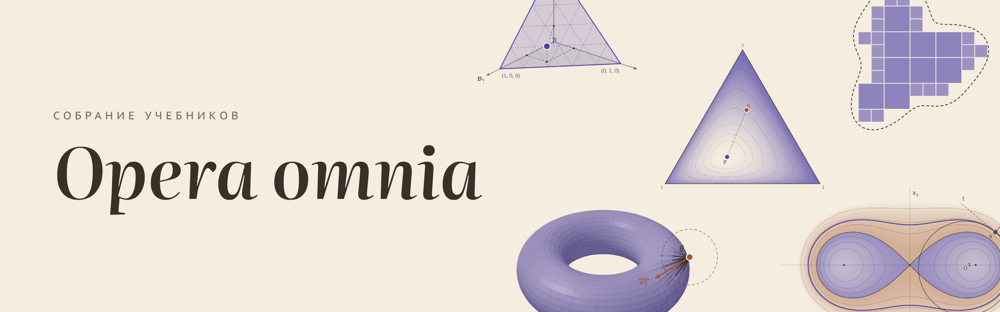

Собрание учебников по математике, машинному обучению и робототехнике на русском языке.

Чтобы понимать описанную здесь работу до конца, нужна математика, которую обычно размазывают по нескольким курсам.
Поэтому здесь растёт **основной учебник** (мера и интеграл, геометрия формы, гауссовские процессы, захват)
и несколько **мини-учебников** на отдельные темы, которые полезны и сами по себе.

## Как читать

Начните с файла `index.html` в корне репозитория: это общая страница всех книг. На ней порядок чтения глав основного учебника,
мини-учебники и поиск по всем утверждениям, рисункам и разделам; щелчок по результату открывает нужную книгу прямо на этом месте.
Ссылки с неё ведут на файлы книг, которые лежат рядом, поэтому скачайте репозиторий целиком (кнопка Code → Download ZIP).
Из меню каждой книги («Содержание», круглая кнопка слева сверху) на общую страницу ведёт ссылка «Все учебники».

Каждая книга или глава — это один HTML-файл. Скачайте его и откройте в любом браузере (Chrome, Firefox, Safari).
Нужен интернет: шрифты и формулы (MathJax) подгружаются из сети. В книгах есть интерактивные рисунки,
сворачиваемые доказательства, навигация (круглая кнопка слева сверху), список обозначений (кнопка Σ)
и переключатель светлой и тёмной темы (справа сверху).

## Что где лежит

`index.html` — общая страница всех книг. Её собирает скрипт `textbook/kit/hub.py` из указателя утверждений глав (`textbook/kit/xref_index.json`),
мини-учебников и обложек из `textbook/kit/covers/`.

### `textbook/` — основной учебник

Главы обозначены символами, а не номерами. Порядок чтения: ∅, ∇, ∠, 𝒩. Упоминания утверждений, упражнений и рисунков в тексте кликабельны:
щелчок показывает само утверждение, а утверждение из другой части открывается в новой вкладке (если файлы лежат в одной папке).

| Файл | Что внутри |
|---|---|
| `ch0_part1_lebesgue.html` | Глава ∅, часть 1. Мера и интеграл Лебега: σ-алгебры, мера Лебега, измеримые функции, интеграл. |
| `ch0_part2_limits.html` | Глава ∅, часть 2. Предельный переход под знаком интеграла: мажорируемая сходимость, дифференцирование под интегралом. |
| `ch0_part3_fubini.html` | Глава ∅, часть 3. Образ меры, плотности, теорема Фубини. |
| `ch1_nabla_geometry.html` | Глава ∇. Геометрия формы: кривизна кривых и поверхностей, неявно заданные фигуры, функция расстояния. |
| `ch1b_random_variables_as_vectors.html` | Глава ∠. Случайные величины как векторы: среднее как проекция, корреляция как косинус угла, что меняется при счётном и несчётном числе исходов, случайная функция как кривая. |
| `ch2_part1_gaussian_vectors.html` | Глава 𝒩, часть 1. Гауссовские векторы (начало главы о гауссовских процессах). |
| `FORMAT.md` | Единые правила оформления всех книг: цвета, кнопки, нумерация, вид доказательств и упражнений. |
| `ch_nabla/PLAN.md` | План главы ∇. |
| `archive/` | Старые версии глав, которые были переписаны. |
| `src_*/` | Исходники глав: текст по разделам (`b*.html`), рисунки (`s_*.html`), скрипты сборки и проверки (`tools/`), заметки (`NOTES.md`). |
| `kit/` | Общий для всех глав слой оформления, который накладывается при сборке. |

### `minibooks/` — мини-учебники

| Файл | Что внутри |
|---|---|
| `cross_entropy/cross_entropy_file.html` | «Кросс-энтропия»: правдоподобие, информация, энтропия, дивергенция Кульбака — Лейблера и почему классификаторы учат именно на кросс-энтропии. Эту версию удобно открывать с диска. |
| `cross_entropy/cross_entropy.html` | Та же книга в виде фрагмента страницы для публикации. |
| `cross_entropy/PLAN.md` | План книги. |
| `cross_entropy/src/`, `cross_entropy/tools/` | Исходники и сборка. |
| `optimizers/optimizers_file.html` | «Оптимизаторы: от случайного перебора до Muon и Shampoo» (пишется, готовы §1–§11). `optimizers_offline.html` открывается без интернета. |
| `optimizers/PLAN.md`, `optimizers/src/`, `optimizers/tools/` | План, исходники и сборка. |
| `value_of_information/PLAN.md` | Черновик плана книги об информационном выигрыше и ценности информации. |
| `FUTURE.md` | Список будущих книг. |

### `notes/` — заметки по статье

Учебник пишется ради статьи о тактильном восприятии формы и выборе касаний для захвата. `notes/backup/paper_backup.md` (и PDF) — её полное описание:
идея, математика, постановка двумерного прототипа, литература, план. Рядом — исходные рабочие заметки.

### `CONTEXT/` — для продолжения работы

Правила, по которым пишутся книги, текущее состояние работы, как собирать и публиковать, и выгрузка памяти помощника.
Входная точка для помощника — `AGENTS.md` в корне.

## Как пересобрать главу

Главы основного учебника собираются из исходников командой `python3 textbook/kit/workspace.py` (все главы) или,
например, `python3 textbook/kit/workspace.py nb` (только глава ∇). Скрипт склеивает разделы и рисунки, расставляет нумерацию,
накладывает общее оформление из `textbook/kit/` и кладёт готовые страницы в `textbook/`. Мини-учебник собирается своим
`minibooks/<книга>/tools/build.py`. Проверочные скрипты `*.cjs` открывают собранную страницу в браузере через Node.js и Playwright
и ищут ошибки и наезжающие друг на друга подписи. Подробности — в `CONTEXT/workflow.md` и в `NOTES.md` каждой главы.

## Лицензия

Тексты, рисунки и страницы книг распространяются по лицензии
[Creative Commons Attribution 4.0](https://creativecommons.org/licenses/by/4.0/deed.ru) (файл `LICENSE`):
их можно читать, копировать, переводить, использовать в своих курсах и переделывать, указав автора.
Скрипты сборки и проверки (`tools/`, `textbook/kit/`) распространяются по лицензии MIT (файл `LICENSE-CODE`).

Автор: Никита Васильев.
